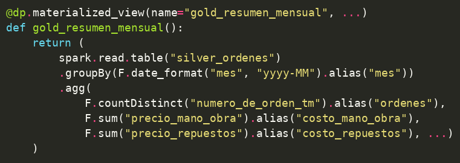
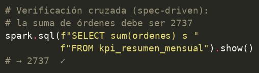
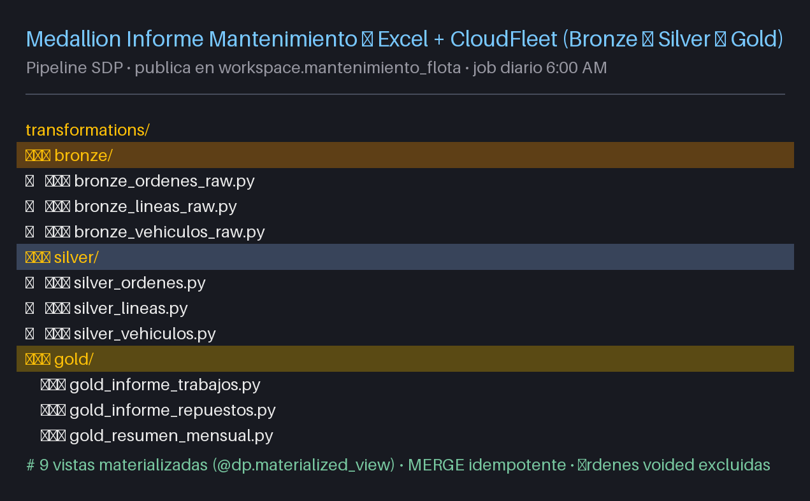
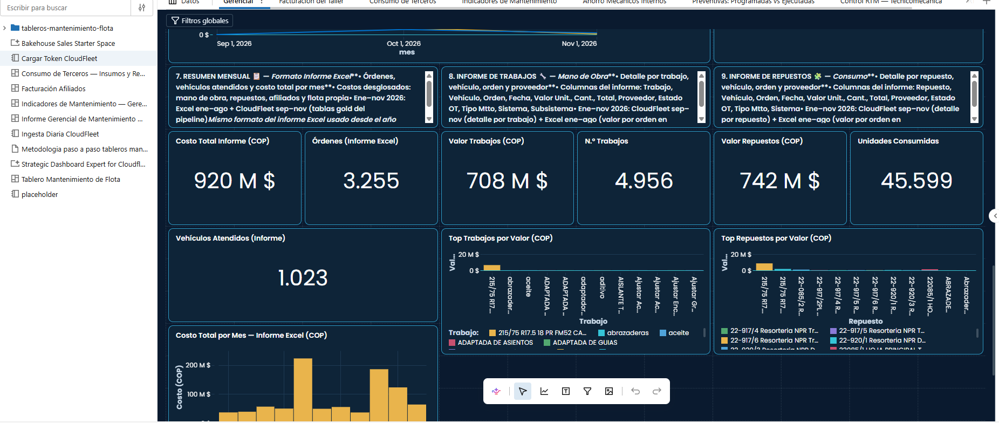
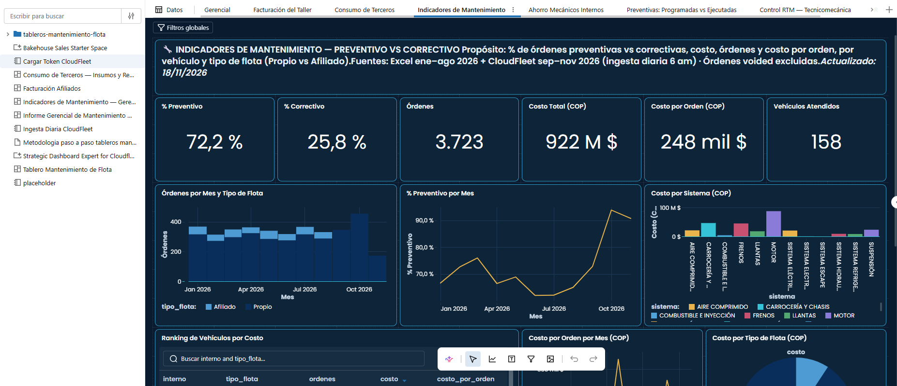
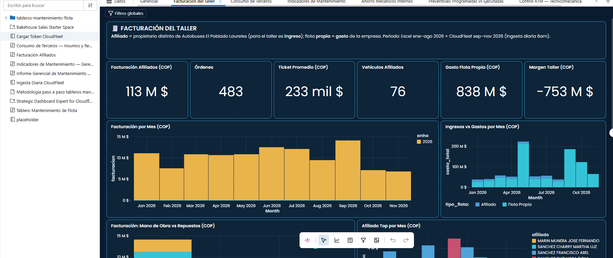

# Mantenimiento-Flota-Vehicular
- Jose Vicente Iguaran
- Jorge Eduardo Acosta Llanos

# 	CASO DEL NEGOCIO
Una empresa de transportes de pasajeros tiene un parque automotor de buses en los cuales hay vehículos flota propia y vehículos de afiliados donde el mantenimiento esta a cargo toda un área de mantenimiento en cabeza de un ingeniero mecánico, se cuenta con un patio taller con mecánicos y un almacén.
El registro de los mantenimientos, repuestos y manos de obra realizados los vehículos se hace mediante un ERP en la nube (cloudfleet)

## Objetivo General
Llevar a cabo una solución de Big Data a través de Databricks aplicando la arquitectura medallion para procesar toda la información diaria que llega y se genera referente al mantenimiento de los vehiculos para finalmente facilitar la toma de decisiones mediante Dashboards con KPis para la gerencial y para el área técnica para el seguimiento del negocio.

## Objetivos Especificos
• Aplicar la Analítica e inteligencia de negocios (BI) a los procesos del area de mantenimiento vehicular.

• Combinar data semiestructurada de históricos de mantenimientos realizados que reposan en archivos de Excel con la data que proviene de la nube.

• Automatizar mediante pipeline la ingesta diaria de datos para actualizar los Dashboards.

# 	RELACION BENEFICIO/ COSTO
Tener la visualización de la información casi que en tiempo real nos Permite:

• Almacén: Revisar salida y entrada de repuestos, ver el comportamiento de la facturacion y hacer mejor control a los proveedores.

• Taller: Visualizar y llevar el control de la facturación de la mano de obra por mecánico, poder comparar los costos con los históricos cuando se tercerizaba los trabajos vs con los Mecánicos Propios.

• Flota: Hacer seguimiento al gasto de los vehículos, por sistemas, por cantidad de ingresos a taller y numero de horas, comparar los mantenimientos correctivos vs los preventivos.

 Todo esto anteriormente con un Software contable y el ERP de mantenimiento no se podía hacer, lo que en la actualidad representa información valiosa para hacer seguimiento al negocio y tomar decisiones en el momento oportuno.

# PIPELINE DE INGESTA DE DATOS
Se perfiló cada Excel antes de cargar (hojas, esquemas, conteos, rangos de fechas, estados de proceso), descubriendo que 452 filas carecían de número de orden (todas con valor 0) y que el histórico no desglosa mano de obra ni repuestos.

Carga bronze desde Excel** con `read_files(format => 'excel', ...)`, normalizando los nombres de columna a snake_case.

Ingesta del API de CloudFleet.** El token se almacena en Databricks Secrets (nunca en texto plano); la descarga es paginada por ventanas de máximo 6 meses y respeta el límite de 30 peticiones/minuto.

Cada orden se normaliza al esquema unificado y se persiste con MERGE por clave (`CF-<número de orden>`); las órdenes anuladas se eliminan para no contaminar los KPIs

Un job ejecuta la ingesta y el recálculo de los KPIs gold diariamente a las 6:00 AM (America/Bogota), sin intervención manual.

Validación de la ingesta.** Cobertura de líneas por mes: nov 100% (167/167), oct 96,7%, sep 98,6%; reconciliación líneas vs. totales de orden: 936/940 exactas.
Datos recreados (muestra parcial).** Fragmento de `mantenimiento_unificado` con el desglose mano de obra / repuestos:

| orden | interno | tipo | M.O. | repuestos | total | fecha |
| --- | --- | --- | --- | --- | --- | --- |
| 963 | 8256 | PREVENTIVO | 37.500 | 0 | 333.699 | 2026-11-12 |
| 960 | 5505 | PREVENTIVO | 37.500 | 0 | 177.749 | 2026-11-12 |
| 961 | 5599 | PREVENTIVO | 0 | 0 | 1.618.154 | 2026-11-12 |

*(Muestra truncada. En 4 órdenes el total difiere de M.O. + repuestos por ajustes a nivel de orden en CloudFleet — detectado por las validaciones.)

# MODELADO ANALÍTICO Y VALIDACIÓN (SPEC-DRIVEN) CON GENIE

Metodología.** En lugar de un modelo de ML, este proyecto aplica análisis descriptivo con validación continua. Cada requisito seguía el ciclo: **especificar** (criterio de aceptación con valor esperado) → **implementar** (Genie genera SQL/datasets/widgets) → **validar** (consulta SQL de reconciliación) → **corregir** (diagnóstico de causa raíz si el test fallaba).

mermaid
flowchart LR
    A["1. Especificar"] --> 
    
    B["2. Implementar con Genie"]
    
    B --> C{"3. Validar"}
    
    C -->|"❌"| D["4. Corregir"] --> B
    
    C -->|"✅"| E["Entregable verificado"] -.-> A
    
Construcción de los KPIs gold.** **Fragmento** de la vista materializada del resumen mensual:

Prueba de la capa gold.** La suma de órdenes de los KPIs debía igualar el conteo de la fuente (2.737). **Fragmento del test**:

Resultados de las validaciones:**

| Regla (spec) | Resultado del test |
| --- | --- |
| Excluir órdenes voided | OK — 0 filas anuladas en KPIs |
| Flota propia según Parque Automotor | 78 propios ($777,3M) / 80 afiliados ($111,3M) — corrigió 124 falsos propios |
| precio_total = M.O. + repuestos | EXACTO en 100 órdenes de afiliados (0 descuadres) |
| Unificación AUTOLARTE | OK — ~$622,9M consolidados |

Defectos detectados y corregidos por las validaciones** (ciclo rojo → verde): (1) regex del motor de dashboards clasificaba mal a los mecánicos; (2) caché rezagado de datasets tras recargas masivas; (3) columna `mes` nula en el MERGE de líneas; (4) 124 vehículos propios falsos; (5) AUTOLARTE invisible desde octubre por atribución por orden en vez de por línea.

 # VISUALIZACIONES - DATABRICKS
 

Visualización:

Se desarrollaron diversos dashboards de gestión con el objetivo de fortalecer el control y seguimiento de los indicadores del área de mantenimiento. 

Estas herramientas permiten:

 . Monitorear las métricas y el desempeño de los diferentes procesos del taller, facilitando la toma de decisiones basada en información actualizada y confiable.

 . Consolidar y visualizar los principales indicadores de gestión del área, garantizando un control integral de la operación y el cumplimiento de los objetivos establecidos.

 . Contar con un tablero especializado para el seguimiento de la facturación general de los vehículos afiliados a la empresa, permitiendo analizar el comportamiento de los ingresos, identificar tendencias y determinar el ticket promedio de facturación.

Gracias a estos dashboards, se mejora la visibilidad de la información, se optimiza el análisis de resultados y se fortalece la gestión operativa y administrativa del área de mantenimiento.

